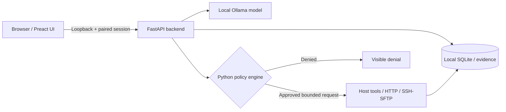

<div align="center">

<h1>Local-first AI security workbench for authorized labs</h1>

**Ollama-powered · Scope-enforced · Evidence-driven · Built for Omarchy/Linux**

[](https://www.python.org/)
[](https://fastapi.tiangolo.com/)
[](https://preactjs.com/)
[](https://ollama.com/)
[](#security-model)
[](#quality-assurance)

**An interactive, locally hosted lab assistant that combines language models with real, explicitly scoped inspection tools — without giving the model an unrestricted shell.**

[Quick start](#quick-start) · [Features](#features) · [Security](#security-model) · [QA](#quality-assurance) · [Documentation](#documentation)

</div>

---

## Overview

BlackBox is a local Ollama chat workbench for security learning and **explicitly authorized** testing. It provides a browser interface, durable conversations, live tool evidence, image support and a Python-enforced execution policy. The model can request bounded operations, but authorization is checked independently by the backend.

> [!IMPORTANT]
> BlackBox is not an autonomous exploitation framework. It intentionally does **not** expose arbitrary shell execution, credential attacks, remote writes, password guessing or privilege escalation. Use it only on systems you own or have explicit permission to assess.

## Features

| Capability | What it does |
| --- | --- |
| **Local model orchestration** | Connect to installed Ollama models; probe model support for tools and vision. |
| **Session authorization** | Pin exact IPs/CIDRs or hostnames, ports, approved read roots, expiry and request budgets. |
| **Bounded network inspection** | Scoped HTTP inspection, ping, TCP-connect Nmap scans and curated public-path discovery. |
| **Read-only SSH/SFTP** | Use local SSH profiles with host-key verification and approved read roots; no remote shell. |
| **Live evidence journal** | Show actual tool inputs, exit codes, durations, denials and evidence alongside model commentary. |
| **Image-aware chat** | Paste or attach up to four normalized PNG, JPEG or WebP images per message. |
| **Durable sessions** | Persist chat history, exports and evidence locally with configurable retention. |
| **Persistent QA** | Run deterministic checks and optional bounded repair cycles in isolated Git worktrees. |

## Screenshot and scan workflows

Authorize your exact local/lab target and ports in **Scope**, then upload a terminal,
web-app, scan, error or diagram screenshot. “Read this screenshot” produces quoted
structured observations, uncertainty and inferred URL candidates. A text-only chat
model can use an installed vision fallback configured in **Settings**; unsupported
images are rejected without losing your draft.

After an image or scan identifies HTTP on a nonstandard port, “Fuzz the web server”
reuses that endpoint and selects bounded ffuf discovery. **Live Activity** shows the
typed plan, why the tool was chosen, actual argv, response codes and cache reuse.
Fresh complete scans are reused by default (15 minutes); “rescan” or “ignore cache”
forces execution. Stale, failed and incomplete outputs stay explicitly labelled.
Multiple matching URLs require an exact target; an IP address does not imply SSH.

Existing Nmap XML, ffuf JSON and terminal exports can be parsed from the private
workspace through `scan.parse` with their original observation timestamp (unknown
time is treated as stale);
`scan.lookup` analyzes scoped saved findings without starting another scan.

Run the controlled demo (no public targets):

```bash
.venv/bin/python scripts/demo_orchestration.py --output qa-reports/orchestration-demo
```

The demo generates a scan screenshot, mocks vision transcription, and uses real
ffuf against a loopback HTTP fixture. It saves the plans, argv, observations, HTTP
codes and cache trace. See [the implementation report](docs/orchestration-report.md).

## Interface

```text
┌──────────────────┬────────────────────────────────────────┬─────────────────────┐
│ SESSIONS         │ TERMINAL / CHAT                        │ LIVE ACTIVITY       │
│                  │                                        │                     │
│ + New session    │  TARGET: scope required                │ Tool requests       │
│                  │  MODEL: local Ollama                   │ Executed arguments  │
│ Previous runs    │                                        │ Results / denials   │
│                  │  Ask BlackBox...                       │ Evidence timeline   │
└──────────────────┴────────────────────────────────────────┴─────────────────────┘
```

*Illustrative layout. The local application runs in your browser; it is not a hosted SaaS service.*

## Architecture



The policy engine enforces scope, budgets and tool limits independently of the model's instructions. Backend restarts revoke active lab scopes.
## Installation

**BlackBox** is built for Linux, with first-class support for Omarchy.

### One-line install

```bash
git clone https://github.com/arnav42069/Blackbox.git && cd Blackbox && ./scripts/install_omarchy.sh
```

### Launch BlackBox

```bash
~/.local/bin/blackbox
```

Open the secure local pairing link printed in your terminal.

**Requirements:** Linux, Python 3.12+, Node.js, npm, Git and a running [Ollama](https://ollama.com/) instance.

> BlackBox runs locally. No cloud API key is required when using locally installed Ollama models.
## Quick start

**Prerequisites:** Linux (Omarchy/Arch is the primary target), Python 3.12+, Node.js/npm and an installed Ollama service.

```bash
# Clone the actual application branch
 git clone --branch qa/orchestrator https://github.com/arnav42069/Blackbox.git
 cd Blackbox

# Install dependencies, build UI and create local launcher
./scripts/install_omarchy.sh

# Confirm environment and tool availability
~/.local/bin/blackbox doctor

# Launch
~/.local/bin/blackbox
```

Open the **one-use pairing link printed in the terminal**. The server binds to `127.0.0.1:8765` by default; don't try to reuse an old pairing link after a restart.

### Choose your Ollama model

```bash
ollama list
# If Ollama isn't already running: ollama serve
blackbox --model qwen3.5:4b
```

You can select other installed models from the app's model menu. Verify vision and tool capability in **Settings → Probe vision + tools** before relying on either capability. BlackBox never silently downloads a model.

### Stop or restart BlackBox

```bash
blackbox kill
blackbox restart
blackbox restart --model huihui_ai/qwen3.5-abliterated:4b
```

These commands work from any directory. Stop uses SIGTERM and escalates to SIGKILL
after three seconds. Restart preserves the startup model, port and data/config
settings, launches the latest already-installed code and prints a new pairing URL.
Every previous scope attestation is revoked. No Git pull, installation or rebuild
runs automatically. With no running instance, restart behaves like normal foreground
startup. With multiple instances, select one using `--data-dir /absolute/path` (or
`BLACKBOX_DATA_DIR`); unrelated services are never selected by a name substring.
The backend holds `server.lock`; lifecycle commands use a separate `lifecycle.lock`
and can shut down a verified backend while its instance lock remains held. Busy
lifecycle operations report their owner after a bounded wait. Lock files are never
deleted to bypass an active owner.

See [process management](docs/cli-process-management.md) for identity verification,
private logs, supported launchers and asset refresh requirements.

### Development server

```bash
./scripts/dev.sh
```

The development script runs the watched frontend build and reloadable FastAPI backend. A backend restart requires a fresh pairing link.

## Authorize a lab

1. Open **Scope** in the application.
2. Specify only approved target IPs, CIDRs or hostnames, TCP ports and read-only SSH roots.
3. Choose an expiry, HTTP budget and whether bounded active scanning is permitted.
4. Confirm the explicit authorization attestation and save.
5. Run a focused inspection task and review its evidence in **Live Activity**.

**Safety defaults:** scope is not inferred from a lab-like IP or a prompt; browser-visible actions never bypass backend enforcement; network tools do not expand their own targets. The model cannot edit scope.

## Security model

- **Loopback-only UI:** paired access to the locally hosted backend; one-use pairing URL and short-lived pairing flow.
- **Independent authorization:** server-side enforcement of targets, ports, time limits and request budgets.
- **Read-only SSH:** local named profiles, strict host-key checking and SFTP-only file reads within allowed roots.
- **Bounded execution:** server-generated tool arguments, process cancellation and no unrestricted command executor.
- **Local persistence:** configuration under `~/.config/blackbox` and private data under `~/.local/share/blackbox`.
- **Evidence separation:** actual tool observations remain distinguishable from model-generated narrative.

See [`docs/security.md`](docs/security.md) and [`docs/tools.md`](docs/tools.md) for the detailed enforcement rules.

## Quality assurance

The `qa/orchestrator` branch includes a deterministic QA workflow and an optional bounded repair loop.

```bash
# Test-only run: no source modification
./scripts/qa-loop.sh --report-only

# One bounded run (may invoke a configured repair worker)
./scripts/qa-loop.sh --once

# Controlled demo in an isolated worktree
./scripts/qa-loop.sh --demo --once --budget-seconds 600

# Stop a running QA loop
./scripts/qa-loop.sh --stop
```

Focused application checks:

```bash
.venv/bin/python -m pytest -q
npm --prefix frontend run typecheck
npm --prefix frontend run build
(cd frontend && npm run test:e2e)
./scripts/smoke_test.sh
```

Reports and locally collected evidence are written under `qa-reports/` (ignored by Git). **Test success is not proof of safety against every target or network environment.** See [`docs/qa-workflow.md`](docs/qa-workflow.md) for safeguards, checkpoints and workflow options.

## Troubleshooting

| Symptom | First check |
| --- | --- |
| Browser says *Failed to fetch* | Is BlackBox still listening on port 8765? Run `ss -ltnp \| grep 8765`. |
| Browser says *401* after restart | Open the newly printed one-time pairing URL. |
| Ollama offline | Check `curl -fsS http://127.0.0.1:11434/api/tags`. |
| Scope denied | Confirm authorized targets, allowed ports, budget and scope expiry. |
| SSH read denied | Check the named profile, SSH host-key trust, path root and current scope. |
| Missing tool | Run `blackbox doctor` and install the reported package. |

## Documentation

- [Security boundaries](docs/security.md)
- [Tool contracts](docs/tools.md)
- [Design and architecture](docs/design.md)
- [QA workflow](docs/qa-workflow.md)
- [Implementation report](docs/implementation-report.md)

---

<div align="center">

**BLACKBOX** · Local control. Explicit scope. Verifiable evidence.

Built for authorized research, practice environments and repeatable testing.

</div>


### Arch/Omarchy dependency tiers

For the complete baseline toolset install `iputils`, `nmap`, and `openssh`:

```bash
sudo pacman -S --needed iputils nmap openssh
```

`ffuf` is preferred for HTTP content discovery. Without it, BlackBox uses its
bounded native HTTP adapter with the same scope, request budget, rate and timeout.
`whatweb` is optional: missing fingerprinting falls back to HTTP headers with an
explicit limitation. `grim` and `wl-clipboard` are optional native Wayland capture
utilities; browser image upload, drag/drop and image paste do not require them.

Startup, `blackbox doctor`, and the UI dependency details report missing packages,
affected capabilities and Arch installation commands. Missing baseline tools disable
their capabilities while the UI and other available tools remain usable. Restart
after installing native tools to refresh the startup inventory. Missing HTTP tools
never select SSH. No automatic package installation or model call is involved in
these checks. The QA orchestrator and its token budgeting remain unchanged.

### Persistent room and flag goals

For an explicitly authorized room/flag goal, BlackBox retrieves existing evidence,
identifies missing service prerequisites and performs permitted HTTP discovery
before considering configured read-only SFTP. Missing SSH credentials limit that
tool; they do not block all discovery. Goal actions and observations appear in
Activity. At a run limit, progress is saved: send **Continue task** to authorize
one further bounded run under the current scope. Cancellation/restart never resumes
work automatically. See [goal orchestration](docs/goal-orchestration.md) for behavior,
regression coverage and limits; a retrieved candidate does not prove room acceptance.
See the [autonomous room workflow](docs/autonomous-room-workflow.md) for exact-target
management, adaptive discovery, home-directory completion criteria and Continue goal.

### Streaming conversation

Assistant replies stream into the chat with Markdown/code/table rendering, copy
controls, a generation cursor and clear execution states. Tool intentions and
observed results appear as collapsible progress; full raw evidence stays in Activity.
Scrolling follows new output until you scroll upward. Stop retains partial text,
and Retry starts another bounded run. A missing/empty/failed model response or budget
limit produces an explicit saved answer/blocker rather than silently returning idle.

See [conversation diagnostics and verification](docs/conversation-streaming.md) for
the event contract, live Ollama check, snapshot/reconnect fixes and exact tests.
The [installed-model response investigation](docs/ollama-response-repair.md) covers
separate thinking/content/tool fields, visible terminal errors, and opt-in live
conversation plus scoped local HTTP acceptance tests. Older backend protocols now
produce a visible restart warning.
Tool failures now return [typed recovery guidance](docs/tool-argument-recovery.md).
Safe argument repairs remain schema/policy checked; identical failed operations
are suppressed so the planner can select a different valid action.
