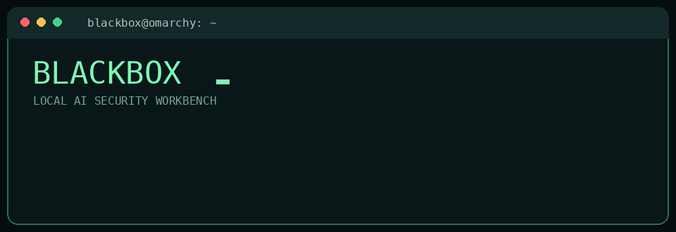
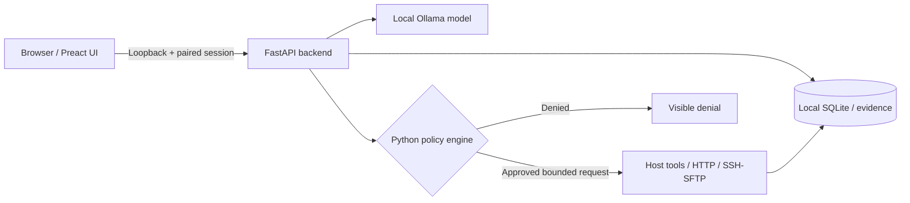

<div align="center">

# ⬛ BLACKBOX

### Local-first AI security workbench for authorized labs

**Ollama-powered · Scope-enforced · Evidence-driven · Built for Omarchy/Linux**



[](https://www.python.org/)
[](https://fastapi.tiangolo.com/)
[](https://preactjs.com/)
[](https://ollama.com/)
[](#security-model)
[](#quality-assurance)

**An interactive, locally hosted lab assistant that combines language models with real, explicitly scoped inspection tools — without giving the model an unrestricted shell.**

[Quick start](#quick-start) · [Features](#features) · [Security](#security-model) · [QA](#quality-assurance) · [Documentation](#documentation)

</div>

---

## Overview

BlackBox is a local Ollama chat workbench for security learning and **explicitly authorized** testing. It provides a browser interface, durable conversations, live tool evidence, image support and a Python-enforced execution policy. The model can request bounded operations, but authorization is checked independently by the backend.

> [!IMPORTANT]
> BlackBox is not an autonomous exploitation framework. It intentionally does **not** expose arbitrary shell execution, credential attacks, remote writes, password guessing or privilege escalation. Use it only on systems you own or have explicit permission to assess.

## Features

| Capability | What it does |
| --- | --- |
| **Local model orchestration** | Connect to installed Ollama models; probe model support for tools and vision. |
| **Session authorization** | Pin exact IPs/CIDRs or hostnames, ports, approved read roots, expiry and request budgets. |
| **Bounded network inspection** | Scoped HTTP inspection, ping, TCP-connect Nmap scans and curated public-path discovery. |
| **Read-only SSH/SFTP** | Use local SSH profiles with host-key verification and approved read roots; no remote shell. |
| **Live evidence journal** | Show actual tool inputs, exit codes, durations, denials and evidence alongside model commentary. |
| **Image-aware chat** | Paste or attach up to four normalized PNG, JPEG or WebP images per message. |
| **Durable sessions** | Persist chat history, exports and evidence locally with configurable retention. |
| **Persistent QA** | Run deterministic checks and optional bounded repair cycles in isolated Git worktrees. |

## Interface

```text
┌──────────────────┬────────────────────────────────────────┬─────────────────────┐
│ SESSIONS         │ TERMINAL / CHAT                        │ LIVE ACTIVITY       │
│                  │                                        │                     │
│ + New session    │  TARGET: scope required                │ Tool requests       │
│                  │  MODEL: local Ollama                    │ Executed arguments  │
│ Previous runs    │                                        │ Results / denials   │
│                  │  Ask BlackBox...                       │ Evidence timeline   │
└──────────────────┴────────────────────────────────────────┴─────────────────────┘
```

*Illustrative layout. The local application runs in your browser; it is not a hosted SaaS service.*

## Architecture



The policy engine enforces scope, budgets and tool limits independently of the model's instructions. Backend restarts revoke active lab scopes.

## Quick start

**Prerequisites:** Linux (Omarchy/Arch is the primary target), Python 3.12+, Node.js/npm and an installed Ollama service.

```bash
# Clone the actual application branch
 git clone --branch qa/orchestrator https://github.com/arnav42069/Blackbox.git
 cd Blackbox

# Install dependencies, build UI and create local launcher
./scripts/install_omarchy.sh

# Confirm environment and tool availability
~/.local/bin/blackbox doctor

# Launch
~/.local/bin/blackbox
```

Open the **one-use pairing link printed in the terminal**. The server binds to `127.0.0.1:8765` by default; don't try to reuse an old pairing link after a restart.

### Choose your Ollama model

```bash
ollama list
# If Ollama isn't already running: ollama serve
blackbox --model qwen3.5:4b
```

You can select other installed models from the app's model menu. Verify vision and tool capability in **Settings → Probe vision + tools** before relying on either capability. BlackBox never silently downloads a model.

### Development server

```bash
./scripts/dev.sh
```

The development script runs the watched frontend build and reloadable FastAPI backend. A backend restart requires a fresh pairing link.

## Authorize a lab

1. Open **Scope** in the application.
2. Specify only approved target IPs, CIDRs or hostnames, TCP ports and read-only SSH roots.
3. Choose an expiry, HTTP budget and whether bounded active scanning is permitted.
4. Confirm the explicit authorization attestation and save.
5. Run a focused inspection task and review its evidence in **Live Activity**.

**Safety defaults:** scope is not inferred from a lab-like IP or a prompt; browser-visible actions never bypass backend enforcement; network tools do not expand their own targets. The model cannot edit scope.

## Security model

- **Loopback-only UI:** paired access to the locally hosted backend; one-use pairing URL and short-lived pairing flow.
- **Independent authorization:** server-side enforcement of targets, ports, time limits and request budgets.
- **Read-only SSH:** local named profiles, strict host-key checking and SFTP-only file reads within allowed roots.
- **Bounded execution:** server-generated tool arguments, process cancellation and no unrestricted command executor.
- **Local persistence:** configuration under `~/.config/blackbox` and private data under `~/.local/share/blackbox`.
- **Evidence separation:** actual tool observations remain distinguishable from model-generated narrative.

See [`docs/security.md`](docs/security.md) and [`docs/tools.md`](docs/tools.md) for the detailed enforcement rules.

## Quality assurance

The `qa/orchestrator` branch includes a deterministic QA workflow and an optional bounded repair loop.

```bash
# Test-only run: no source modification
./scripts/qa-loop.sh --report-only

# One bounded run (may invoke a configured repair worker)
./scripts/qa-loop.sh --once

# Controlled demo in an isolated worktree
./scripts/qa-loop.sh --demo --once --budget-seconds 600

# Stop a running QA loop
./scripts/qa-loop.sh --stop
```

Focused application checks:

```bash
.venv/bin/python -m pytest -q
npm --prefix frontend run typecheck
npm --prefix frontend run build
(cd frontend && npm run test:e2e)
./scripts/smoke_test.sh
```

Reports and locally collected evidence are written under `qa-reports/` (ignored by Git). **Test success is not proof of safety against every target or network environment.** See [`docs/qa-workflow.md`](docs/qa-workflow.md) for safeguards, checkpoints and workflow options.

## Troubleshooting

| Symptom | First check |
| --- | --- |
| Browser says *Failed to fetch* | Is BlackBox still listening on port 8765? Run `ss -ltnp \| grep 8765`. |
| Browser says *401* after restart | Open the newly printed one-time pairing URL. |
| Ollama offline | Check `curl -fsS http://127.0.0.1:11434/api/tags`. |
| Scope denied | Confirm authorized targets, allowed ports, budget and scope expiry. |
| SSH read denied | Check the named profile, SSH host-key trust, path root and current scope. |
| Missing tool | Run `blackbox doctor` and install the reported package. |

## Documentation

- [Security boundaries](docs/security.md)
- [Tool contracts](docs/tools.md)
- [Design and architecture](docs/design.md)
- [QA workflow](docs/qa-workflow.md)
- [Implementation report](docs/implementation-report.md)

---

<div align="center">

**BLACKBOX** · Local control. Explicit scope. Verifiable evidence.

Built for authorized research, practice environments and repeatable testing.

</div>
