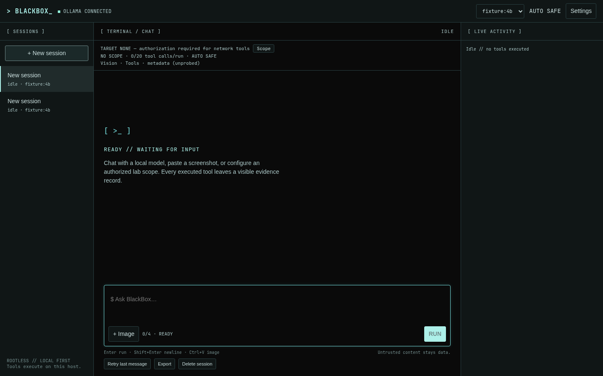
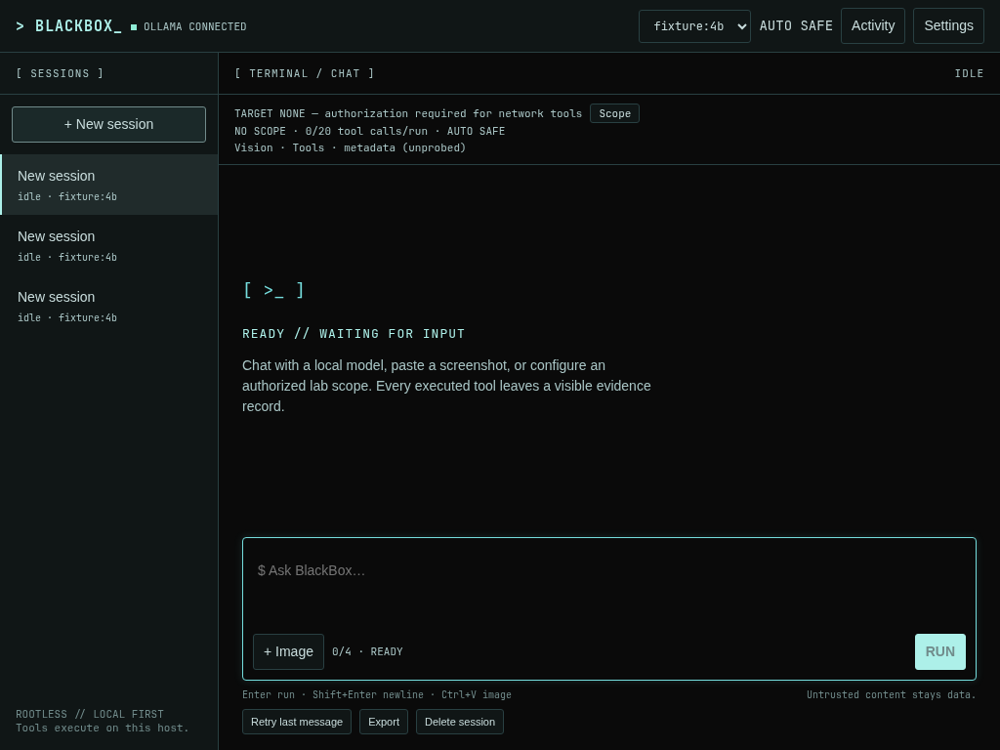
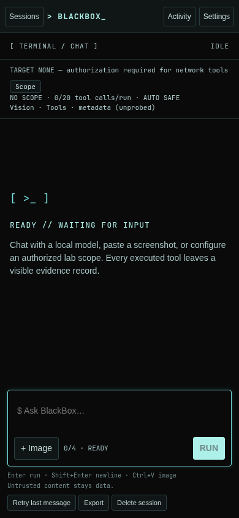

# BlackTurq design

Reference: [HANCORE-linux/omarchy-blackturq-theme](https://github.com/HANCORE-linux/omarchy-blackturq-theme),
MIT upstream `colors.toml`. BlackBox includes color values as reference data, not
upstream wallpapers, icons, scripts or desktop configuration.

| Base token | Hex |
|---|---|
| bg / ansi-black / selection foreground | #0A0A0A |
| fg / selection background | #C8DCDC |
| accent | #ADF0E9 |
| cursor | #75DDDD |
| red | #D35F5F |
| green | #8FECD5 |
| cyan-muted | #A9D1D7 |
| muted-deep | #485362 |
| muted | #5A676B |
| terminal-bright | #D2D9DB |
| ansi-bright-black | #322F3B |

`frontend/src/styles/tokens.css` holds every base and derived color. BlackBox's
own derived surfaces are #101616 / #152020 / #1B2929, borders #294042, secondary
text #A9C5C5 and disabled text #718B8B. Body uses system sans; local monospace
fallbacks serve tool traces, paths and labels. No fonts or assets load from a CDN.

A 54 px bar tops a 224 px sessions rail, fluid conversation and 340 px activity
pane. Below 1100 px, Activity becomes a drawer; below 720 px, Sessions also becomes
a drawer. Composer stays visible; overflow stays inside panes/code blocks. Focus
has a visible turquoise outline/border. Reduced-motion disables cursor animation.
Optional header texture is off by default and never covers text/images/composer.

Messages label user/model separately. Tool cards have explicit RUNNING, SUCCESS,
DENIED, FAILED and CANCELLED states, with timestamps, args, exit and duration.
Verified successes use mint; focus/running use turquoise; blocked/error states use
red. Markdown is sanitized. Attachment previews preserve aspect ratio and show
name/size/removal. Scope authorization is a contextual form, not a browser popup.

Screenshots below are generated by Playwright using an explicitly labeled local
model fixture, not a simulated production result. Exact colors, viewport overflow,
composer visibility, focus, AA text/status/action contrast, reduced motion and default effects are asserted in the browser tests.

